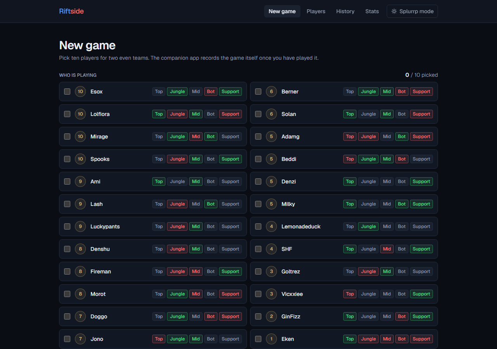
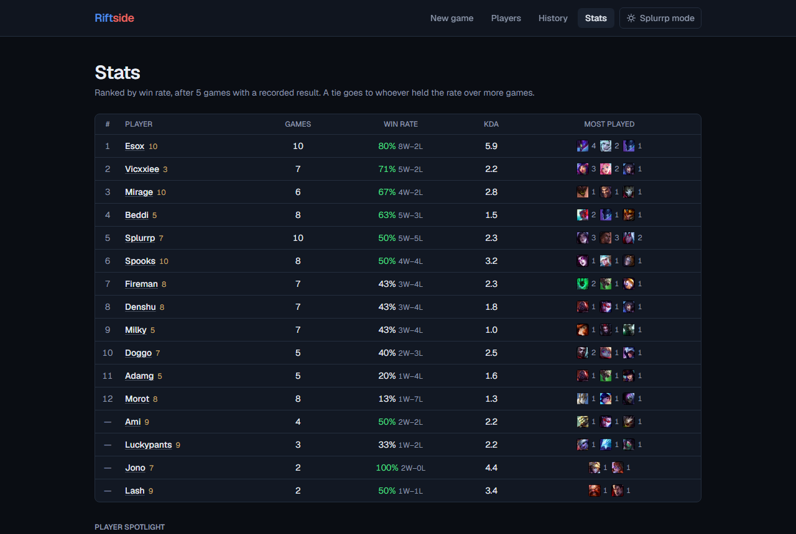
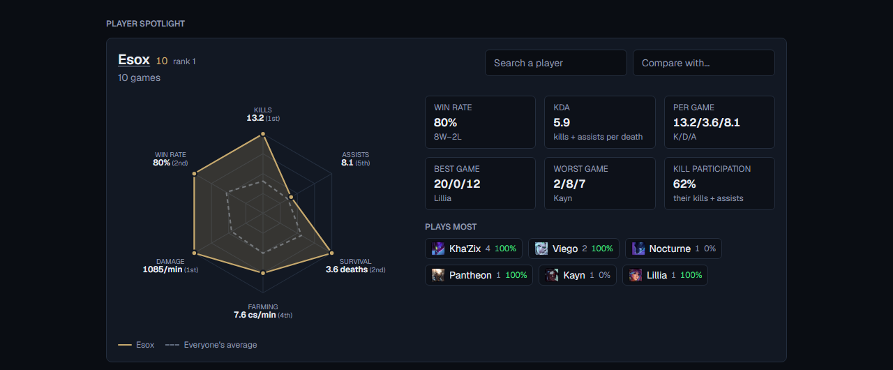
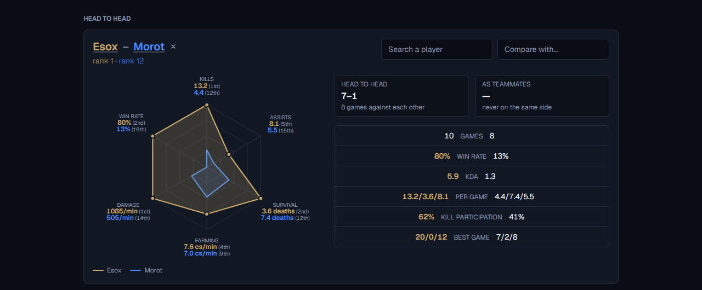

# Riftside

**[riftside.vercel.app](https://riftside.vercel.app)**

A private site for running 5v5 in-house League of Legends games with a fixed
group of friends. Pick the ten people playing tonight, and it splits them into
two even teams and suggests a role for each player. When the game finishes, a
companion app on one player's PC notices and records it — champions, K/D/A, CS,
gold, damage, bans — with nothing to type in by hand.

Riot's public API does not expose custom games, so the stats on this site
cannot be fetched from anywhere. They are read out of the League client's own
local API as the games finish, or they are lost.

---

## A look at it

**Pick the ten who are playing.** The number on the left is how good someone
is overall; the roles beside each name are how happy they are to play there —
Main, Fill or Never.



**The ladder.** Win rate first, then more games at the same rate, then KDA.
Anyone under five games with a recorded result is unranked rather than
flattering themselves with a 100% from one win.



**One player against everyone else.** The gold shape is the player, the dashed
one is the group's average, and each axis carries the figure and where it
places among everyone measured the same way. Someone who mostly plays support
gets Vision in place of Farming, because CS says nothing about how they
played.



**Two players against each other.** Pick a second and the panel becomes a head
to head: how they have done against each other, how they have done as
teammates, both shapes on one chart, and the figures facing each other with
whoever leads each row picked out. Where the two are not measured the same way
— a support's vision against a laner's CS — that axis is dropped rather than
compared, leaving a five-sided chart.



## What it does

| Page | |
| --- | --- |
| **New game** | Pick ten players, get the three best team splits with suggested roles |
| **Players** | The roster: a power level and a comfort level per role |
| **History** | Past games, line-ups in role order, full scorelines |
| **Stats** | The ladder, a per-player radar spotlight, head to heads, and assorted records |

Reading is public. Every write is behind a login.

## How a game gets recorded

```
League client                companion app              riftside.vercel.app
(local LCU API)      ──▶     (Node, one PC)      ──▶    POST /api/ingest
  finished game              polls, parses,              validate, link to
  on loopback HTTPS          sends once                  players, store
```

The companion is **read-only**: it never sends a command to the client. It
authenticates against the client with the lockfile credentials every League
install writes to disk, accepts the client's self-signed certificate on
loopback only, and posts finished in-house games to the site with a shared
secret.

The website is the single record of what has been sent. The companion keeps no
local list of sent games — one would disagree with reality the moment a game
was deleted on the site — and re-sending is free, because ingest is idempotent.

## The parts worth reading

**The balancer** (`lib/balance.ts`) is a pure TypeScript module with no React
or database imports, covered by 23 unit tests. Ten players split into two teams
of five is only 126 unique splits, and each team has 120 role assignments, so
it brute-forces the whole space instead of guessing. It runs in the browser:
the search is cheaper than a round trip, and the suggestions re-rank instantly
as the selection changes.

Its one rule is that **two systems never leak into each other**: team strength
is the sum of power levels and roles never change it; role fit is how happy
players are with their assigned role and comfort never contributes to strength.

**Roles come from the game, not from a guess.** The League client reports a
`lane` for every participant, derived from where they walked — in a real
in-house game of ours it returned three junglers and no top. The reliable
signal turned out to be the role quest reward item the game hands out by lane.
That was found by reading archived payloads, not from documentation, and it
replaced an entire hand-entry feature: once the game itself says who played
what, asking people to record it is redundant.

**Ingest is idempotent** on Riot's game id, which carries a UNIQUE constraint.
The route checks for an existing game first, but that check races — two
companions can both pass it — so the constraint is the actual guarantee and the
violation is caught and reported as a duplicate rather than a failure.
Participants are matched on PUUID first and Riot ID second, never two to the
same player, and a name match backfills the PUUID so the guess is needed once.

**Every game's full client response is archived.** That paid off directly: when
the stats needed vision score, which had never been stored as a column, the
migration that added the column backfilled it out of the archived payloads —
all 100 existing participant rows, no data lost to a schema decision made
months earlier.

**The stats know what a support is.** CS is not counted for a game played on
support, because a support finishes on a fraction of a laner's CS by design and
counting those games quietly punished whoever filled. Someone who supports more
often than not gets a Vision axis on their radar in place of Farming, scaled
against the other supports rather than against laners' CS.

**The radar changes type with its job.** Against the group it is an *emphasis*
chart: the player is the subject in the accent colour and the average is
recessive context, a dashed outline with no fill. Against another player it is
a *categorical* one — two equals — so the second shape takes a hue of its own
and the same weight. Either way the two never depend on colour alone to be
told apart, and every axis carries its figure as text, so the shapes are
readable without comparing areas by eye. Both palettes went through a
colour-blindness validator rather than a glance; an earlier one failed it and
was replaced.

**The records behind a head to head are one pass over every game.** Ten
players make forty-five pairs, so the work grows with games played rather than
with the roster, and the whole table is handed to the browser — switching
opponent costs no round trip. Only games with a recorded winner count towards
a record: a 3-0 that quietly included two unfinished games would be worse than
no record at all.

**Auth is one password, not an auth provider.** scrypt for the hash, a signed
JWT in an HttpOnly SameSite=Lax cookie, and a guard inside every mutating
server action — server actions are reachable by direct POST, so hiding a button
protects nothing. The tests cover forged, expired and `alg: none` tokens.

Wrong guesses are counted **in Postgres**, not in memory: the site runs in
serverless functions, where an in-memory counter resets on a cold start and
disagrees between instances, which makes it no limit at all. Eight failures
from an address inside fifteen minutes shuts it out, and signing in clears the
slate. Addresses are stored as a salted hash — the throttle needs to recognise
a repeat visitor, not to know who they are.

## Stack

- **Next.js 16** (App Router) + **React 19** + **TypeScript** in strict mode
- **Tailwind CSS v4**, dark by default, light theme opt-in through CSS tokens
- **Neon Postgres** via `@neondatabase/serverless`
- **Drizzle ORM** with tracked SQL migrations (`drizzle-kit generate`, never `push`)
- **Vitest** — 100 tests over the balancer, ingest rules, role assignment, auth, hashing and the companion's parser
- **Vercel** — pushing to `master` deploys
- Companion: **Node 24** running TypeScript directly by type-stripping, one runtime dependency (`ws`)

`cacheComponents` is on, so every uncached database read sits inside its own
`<Suspense>` boundary and the pages stream rather than block on the slowest
query.

## Running it

```bash
npm install
cp .env.example .env.local     # fill in the values below
npm run db:migrate
npm run dev
```

| Variable | |
| --- | --- |
| `DATABASE_URL` | Pooled connection, used at runtime |
| `DATABASE_URL_UNPOOLED` | Direct connection, used by drizzle-kit |
| `AUTH_SECRET` | Signs the session cookie |
| `ADMIN_PASSWORD_HASH` | From `npm run auth:new` |
| `INGEST_SECRET` | Shared with the companion app |

```bash
npm run build     # must pass before every commit
npm run lint
npm test
```

The companion has [its own README](companion/README.md).

## Layout

```
app/
  new-game/     pick ten, balance            players/    roster CRUD
  history/      past games                   stats/      ladder, spotlight
  login/        the one account              api/ingest/ receives games
components/     shared UI
db/             schema, queries, migrations
lib/            balance, roles, ingest rules, auth, types   ← the pure modules
companion/      the Windows companion app (separate package)
```

The pure modules in `lib/` hold every rule worth testing and import nothing
from Next.js, which is what makes them testable without a database or a
browser.

## Built with Claude Code

This was written by me together with [Claude Code](https://claude.com/claude-code),
and the way that collaboration was set up is a deliberate part of the project.

[`CLAUDE.md`](CLAUDE.md) is the working agreement: the stack, the domain rules
that must not be violated, the conventions, and — importantly — what *not* to
do. It carries the reasoning behind decisions that are not obvious from the
code, so neither of us re-litigates them later: why the client's lane guess is
ignored, why the password hash uses `.` as a separator rather than `$`, why
line-ups are ordered by the role quest item.

The working rules that made it productive:

- **A plan before code**, in small steps, with `npm run build`, `npm run lint`
  and `npm test` green before each commit.
- **Rules live in tests, not in prose.** The balancer's tie-breaking, the
  ingest validation and the role assignment are pure functions with unit tests,
  so a change that breaks a rule fails immediately instead of being noticed in
  a game three weeks later.
- **Verification proportional to risk.** Build, lint and tests always. A
  browser only for behaviour the build cannot see — hydration, a server action,
  a new database write. Not for CSS or copy. Over-verifying is a real cost, and
  the rule is written into `CLAUDE.md` so it is applied consistently.
- **Real payloads over remembered field names.** The LCU API is undocumented
  and unversioned, so the companion's parser was built from dumped responses
  and is tested against committed fixtures. Three fields are not what anyone
  would guess: `teams[].win` is the string `"Win"`/`"Fail"`, CS is
  `totalMinionsKilled` **plus** `neutralMinionsKilled`, and
  `participantIdentities` joins on `participantId` rather than list position.

The judgement calls stayed mine — what to build, what to cut, what the rules
of the domain actually are. Removing the hand-entry feature and taking roles
from the role quest instead came from knowing how the game works, not from the
code.

---

Riftside is not endorsed by Riot Games and does not reflect the views of Riot
Games or anyone officially involved in producing or managing League of Legends.
